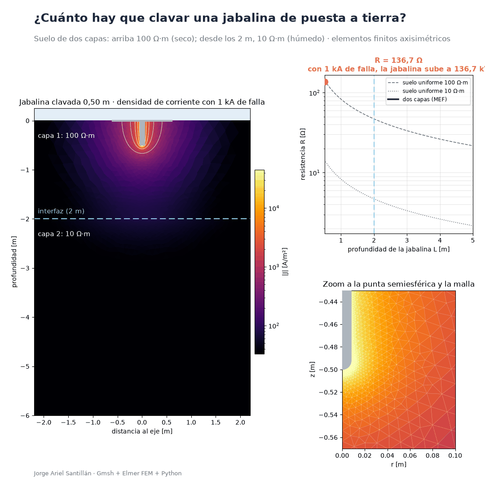
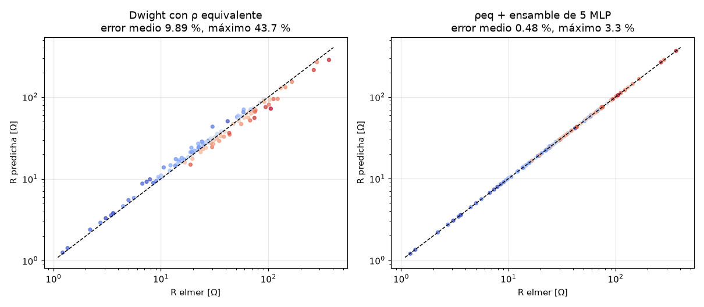
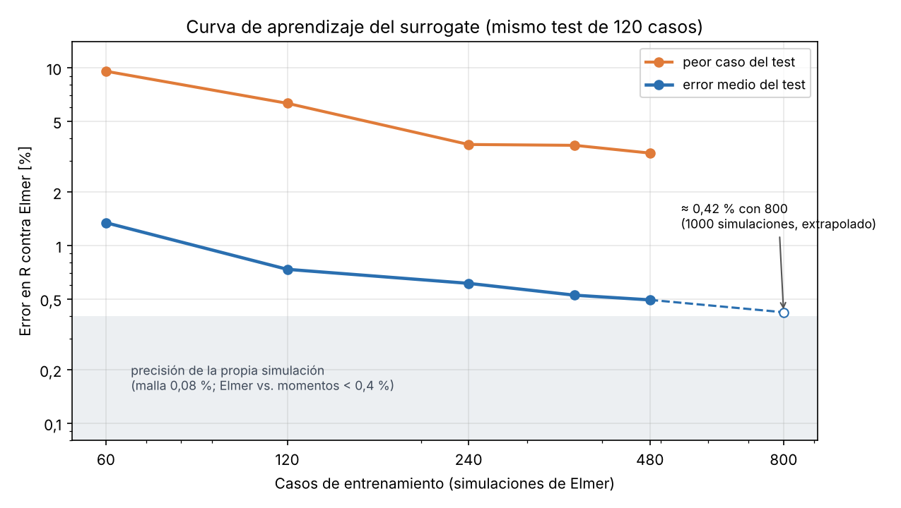
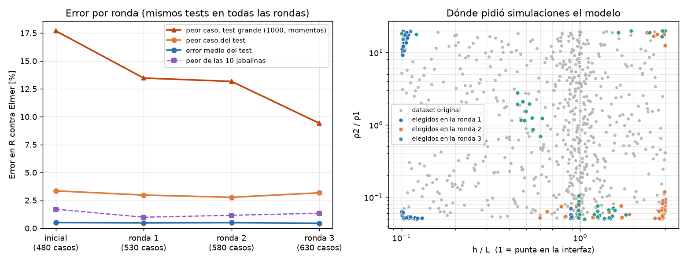
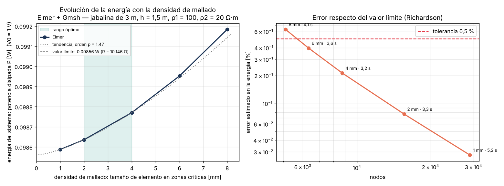
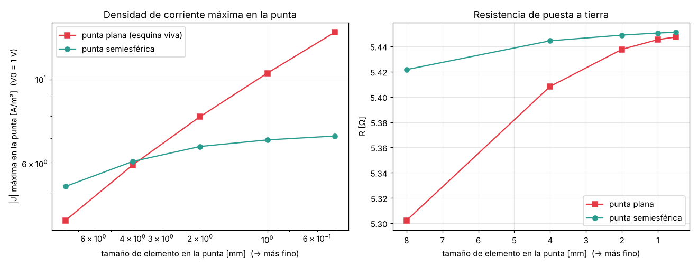

# ⚡ Puesta a tierra en suelo de dos capas: elementos finitos + machine learning

**Autor:** Jorge Ariel Santillán

## El problema

Una jabalina de puesta a tierra tiene que tener una resistencia baja para que, ante una falla, las tensiones sobre las personas sean seguras. La fórmula clásica (Dwight) supone un suelo uniforme, pero el suelo real tiene capas: por ejemplo, tierra seca arriba y una napa húmeda más abajo. En esos casos la fórmula puede equivocarse por un factor de 10 o más, y las aproximaciones de ingeniería (resistividad equivalente) se desvían hasta un 44 %.

## La solución

1. **Simulación por elementos finitos** del problema axisimétrico con herramientas libres: geometría y malla paramétricas en **Gmsh** (punta semiesférica, refinamiento en la jabalina, la punta y la interfaz) y solución en **Elmer FEM**.
2. **Validación** contra un motor analítico propio (método de los momentos con la función de Green de dos capas de Sunde): diferencia menor al 0,5 %.
3. **Estudio de convergencia de malla por energía:** la potencia disipada P = V²/R se calcula para mallas cada vez más finas; con 2 mm en las zonas críticas el error estimado es 0,08 % y el tiempo por caso no aumenta.
4. **Barrido automático de 600 casos** (Python controla Gmsh + Elmer, en paralelo, con reanudación y control de errores), más **150 casos elegidos por el propio modelo** con aprendizaje activo.
5. **Surrogate:** la fórmula de ingeniería más una corrección aprendida por un ensamble de redes neuronales. Predice R en milisegundos en lugar de segundos por simulación.

## Resultados

| Método | Error medio en R | Peor caso |
|---|---|---|
| Dwight con suelo uniforme | > 100 % | > 1000 % |
| Dwight con resistividad equivalente | 9,9 % | 44 % |
| **Fórmula + corrección con ensamble de redes** | **0,45 %** | **3,2 %** |

*Conjunto de test: 120 simulaciones de Elmer que el modelo no vio durante el entrenamiento, fijas desde el principio (20 % de los 600 casos originales). El modelo se entrenó con los otros 630: 480 originales + 150 de aprendizaje activo.*

### Validación con 10 jabalinas nuevas

Para probar el modelo fuera del test, se simularon en Gmsh + Elmer 10 jabalinas con geometrías y suelos realistas: diámetros comerciales de 1/2" a 3/4", largos de 1,5 a 6 m y ρ₁ entre 30 y 1000 Ω·m. El modelo se entrenó solo con a = 8 mm y ρ₁ = 100 Ω·m, así que estos casos prueban que las variables adimensionales generalizan.

| | Error medio | Peor caso |
|---|---|---|
| Dwight con resistividad equivalente | 12,3 % | 37,8 % |
| Surrogate (500 casos) | 1,10 % | 7,5 % |
| Surrogate (600 casos) | 0,82 % | 3,3 % |
| **Surrogate (750 casos, con aprendizaje activo)** | **0,57 %** | **1,8 %** |
| Método de los momentos (control de Elmer) | 0,33 % | 0,41 % |

**Aprendizaje activo:** la primera validación encontró el punto débil del modelo. Una jabalina de 3 m con la napa a 2,9 m (solo los últimos 10 cm en la capa conductora) daba 7,5 % de error: ahí la corriente se concentra en la punta y R cae bruscamente, y el dataset tenía pocos casos con h/L ≈ 1. Se agregaron 100 simulaciones con h/L entre 0,85 y 1,1, se reentrenó y el error bajó a 3,3 %, sin cambiar nada más. Después el aprendizaje activo automático (ver más abajo) lo llevó a 1,8 %.

### ¿Hacen falta más simulaciones?

Para decidirlo con datos, se entrenó el mismo ensamble con 60, 120, 240, 360 y 480 casos y se midió siempre contra el mismo test de 120 simulaciones.

| Casos de entrenamiento | Error medio | Peor caso |
|---|---|---|
| 60 | 1,34 % | 9,6 % |
| 120 | 0,73 % | 6,3 % |
| 240 | 0,61 % | 3,7 % |
| 480 | 0,49 % | 3,3 % |

Al principio los datos rinden mucho: de 60 a 240 casos el error se reduce a menos de la mitad. Después cada duplicación lo baja solo un 20 % (el error cae como n^−0,31). Con 1000 simulaciones el error medio quedaría cerca de 0,42 %, ya dentro de la precisión de la propia simulación (malla 0,08 %; Elmer contra el método de los momentos, menos de 0,4 %). Conclusión: más casos al azar no mejoran el modelo de forma apreciable. Las simulaciones nuevas conviene ubicarlas donde el modelo duda, como se hizo con la jabalina 4.

### Aprendizaje activo: el modelo elige qué simular

En vez de sumar casos al azar, el modelo decide qué le falta. En cada ronda:

1. Genera 20 000 candidatos y los evalúa con las 5 redes del ensamble (0,2 s).
2. Mide cuánto discrepan las redes entre sí en cada candidato: donde discrepan, el modelo duda.
3. Manda a Elmer solo los 50 candidatos con más desacuerdo (unos 40 s) y se reentrena.

Para medir zonas que el test de 120 casos no llega a cubrir, se agregó un test grande de 1000 casos repartidos por todo el rango, resuelto con el método de los momentos (difiere de Elmer en unos 0,3 %, suficiente para detectar errores grandes). Ese test encontró un punto débil oculto: **17,7 % de error** con la punta apenas dentro de una capa unas 18 veces más conductora.

| | Inicial | Ronda 1 | Ronda 2 | Ronda 3 |
|---|---|---|---|---|
| Casos de entrenamiento | 480 | 530 | 580 | 630 |
| Test de 120: error medio | 0,51 % | 0,48 % | 0,50 % | **0,45 %** |
| Test grande (1000): peor caso | 17,7 % | 13,5 % | 13,2 % | **9,4 %** |

Con 150 simulaciones, el peor caso del test grande bajó casi a la mitad. En un ensayo previo (con el método de los momentos como referencia en todo), 150 casos al azar no lo mejoraban: el peor caso quedaba en 17 %. El gráfico de la derecha muestra dónde pidió simulaciones el modelo: en los bordes del rango y cerca de la interfaz, justo donde el dataset original tenía menos información.

## Decisiones técnicas

- **Análisis dimensional:** R·L/ρ₁ depende solo de L/a, h/L y ρ₂/ρ₁. El modelo aprende en esas variables y generaliza a cualquier escala.
- **Física + datos:** la red no aprende R desde cero, sino la corrección sobre la fórmula de ingeniería. Así el error medio baja de 9,9 % a 0,45 %.
- **Punta semiesférica:** con punta plana, la densidad de corriente en la punta crece sin límite al refinar la malla (singularidad de esquina); con punta curva converge.

  
- **Dominio finito:** el potencial cero a distancia finita se corrige con ρ₂/(2π·R_dominio).
- **Muestreo dirigido:** se agregaron casos donde la punta queda cerca de la interfaz, la zona donde R cambia más bruscamente; la validación externa mostró dónde hacían falta más (ver arriba).

## Tecnologías

Gmsh · Elmer FEM · Python (NumPy, SciPy, scikit-learn, Matplotlib) · PowerShell

## Código fuente

El código es privado y está **disponible a pedido** para procesos de selección.

Contacto: georgesantillan1617@gmail.com · https://www.linkedin.com/in/jorge-ariel-santill%C3%A1n-235593183/
