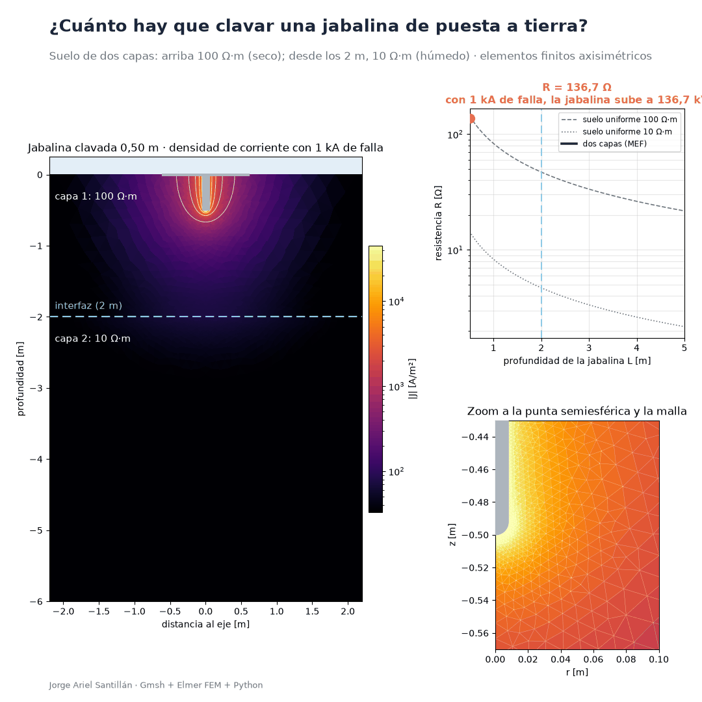
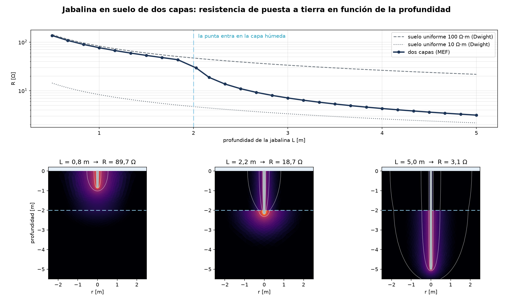
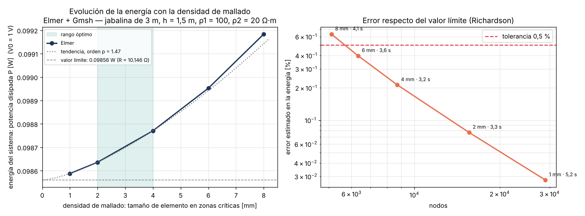
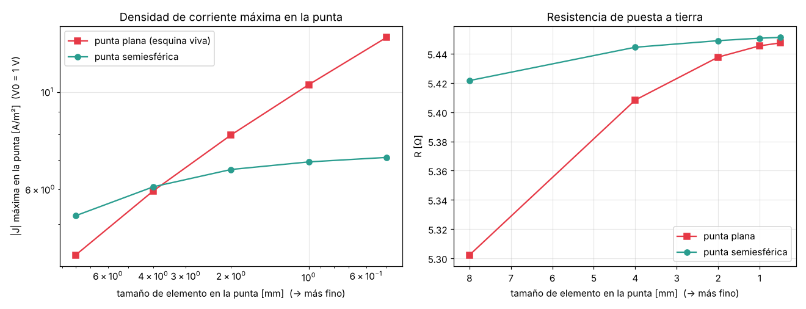

# ⚡ Puesta a tierra en suelo de dos capas: elementos finitos + machine learning

**Autor:** Jorge Ariel Santillán

## El problema

Una jabalina de puesta a tierra tiene que tener una resistencia baja para que, ante una falla, las tensiones sobre las personas sean seguras. La fórmula clásica (Dwight) supone un suelo uniforme, pero el suelo real tiene capas: por ejemplo, tierra seca arriba y una napa húmeda más abajo. En esos casos la fórmula puede equivocarse por un factor de 10 o más, y las aproximaciones de ingeniería (resistividad equivalente) se desvían hasta un 44 %.

## La solución

1. **Simulación por elementos finitos** del problema axisimétrico con herramientas libres: geometría y malla paramétricas en **Gmsh** (punta semiesférica, refinamiento en la jabalina, la punta y la interfaz) y solución en **Elmer FEM**.
2. **Validación** contra un motor analítico propio (método de los momentos con la función de Green de dos capas de Sunde): diferencia menor al 0,5 %.
3. **Estudio de convergencia de malla por energía:** la potencia disipada P = V²/R se calcula para mallas cada vez más finas; con 2 mm en las zonas críticas el error estimado es 0,08 % y el tiempo por caso no aumenta.
4. **Barrido automático de 500 casos** (Python controla Gmsh + Elmer, en paralelo, con reanudación y control de errores).
5. **Surrogate:** la fórmula de ingeniería más una corrección aprendida por un ensamble de redes neuronales. Predice R en milisegundos en lugar de segundos por simulación.

## Resultados

| Método | Error medio en R | Peor caso |
|---|---|---|
| Dwight con suelo uniforme | > 100 % | > 1000 % |
| Dwight con resistividad equivalente | 8,7 % | 44 % |
| **Fórmula + corrección con ensamble de redes** | **0,54 %** | **4,0 %** |

*Conjunto de test: 100 simulaciones de Elmer que el modelo no vio durante el entrenamiento (80 % / 20 % de 500 casos).*

## Decisiones técnicas

- **Análisis dimensional:** R·L/ρ₁ depende solo de L/a, h/L y ρ₂/ρ₁. El modelo aprende en esas variables y generaliza a cualquier escala.
- **Física + datos:** la red no aprende R desde cero, sino la corrección sobre la fórmula de ingeniería. Así el error medio baja de 8,7 % a 0,54 %.
- **Punta semiesférica:** con punta plana, la densidad de corriente en la punta crece sin límite al refinar la malla (singularidad de esquina); con punta curva converge.

  
- **Dominio finito:** el potencial cero a distancia finita se corrige con ρ₂/(2π·R_dominio).
- **Muestreo dirigido:** se agregaron casos donde la punta queda cerca de la interfaz, la zona donde R cambia más bruscamente.

## Tecnologías

Gmsh · Elmer FEM · Python (NumPy, SciPy, scikit-learn, Matplotlib) · PowerShell

## Código fuente

El código es privado y está **disponible a pedido** para procesos de selección.

Contacto: [TU EMAIL] · [TU LINKEDIN]
